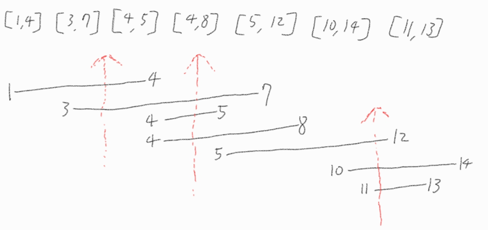
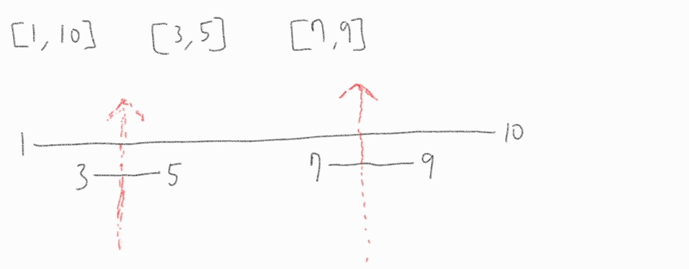
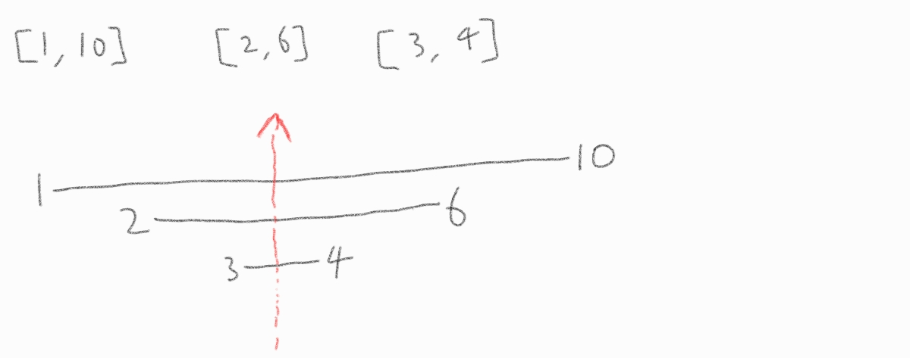

# [[프로그래머스/LV2] 요격시스템 - Math (Java)](https://school.programmers.co.kr/learn/courses/30/lessons/181188)


## 🙋‍♂️ 들어가며

이 문제를 풀기 위해서는 그림을 그려보면 알 수 있다.

최악의 실행연산은
- N = 50만
- 정렬 N Log N -> 50만 Log 50만

즉 50만 * 19 -> 950만

그리고 50만

합해서 1000만

<br><br><br>

## 🎲 tc-1 


<br>

## 🎲 tc-2


<br>

## 🎲 tc-3


<br><br>


## ✅ 코드 (Math)

```java
import java.util.Arrays;

class Solution {
    public int solution(int[][] targets) {
        int answer = 0;
        
        // 1. 람다 정렬
        Arrays.sort(targets, (a,b) -> {
            // 1-1. 만약 앞이 같으면 뒤정렬
            if (a[0] == b[0]) {
                return Integer.compare(a[1], b[1]);
            }
            
            // 1-2. 그외는 앞정렬
            return Integer.compare(a[0], b[0]);
        });
        
        
        // 2. 초기값 추가
        int start_s = targets[0][0];
        int start_e = targets[0][1];
        answer++;
        
        // 3. 검사
        int N = targets.length;
        for (int i = 1; i < N; i++) {
            int cur_s = targets[i][0];
            int cur_e = targets[i][1];
            
            // 3-1. 만약 start_e > cur_s 일때
            if (start_e > cur_s) {
                // 3-1-a. 만약 start_e < cur_e -> skip
                if (start_e < cur_e) continue;
                
                // 3-1-b. 그외 (start_e 길이축소) 그리고 skip
                start_e = cur_e;
                continue;
            }
            
            // 3-2. 그렇지 않고, start_e <= cur_s 일때
            else if (start_e <= cur_s) {

                // 3-2-a. 시작좌표s,e 둘다 cur_s, cur_e보다 못미치면? 갱신
                if (start_s < cur_s && start_e < cur_e) {
                    start_s = cur_s;
                    start_e = cur_e;
                    answer++;
                    continue;
                }
                
                // 3-2-b. 그렇지않고, 시작좌표는 같지만, 끝좌표가 다르면? -> 끝좌표만 갱신
                else if (start_e == cur_s && start_e < cur_e) {
                    start_e = cur_e;
                }
            }
            
            
        }
        
        return answer;
    }
}
```