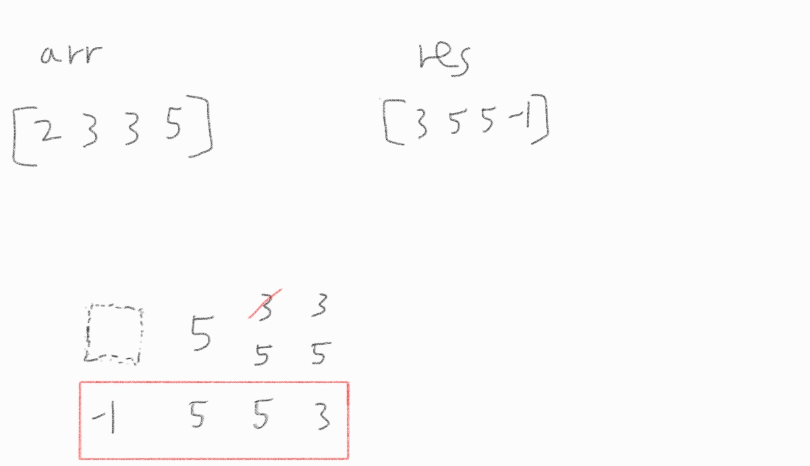
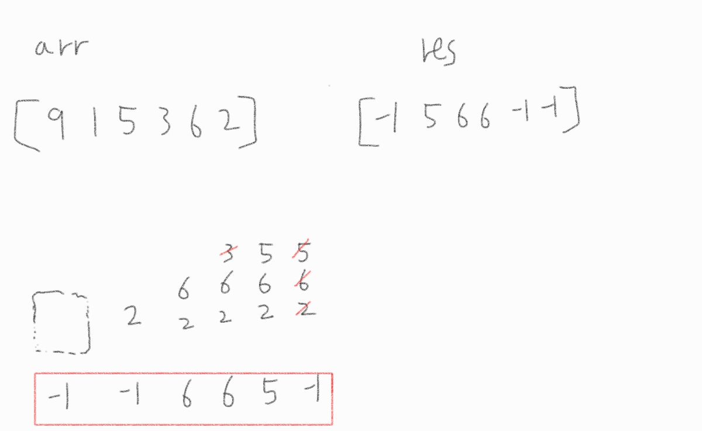

# [[프로그래머스/LV2] 뒤에 있는 큰수 찾기 - stack (Java)](https://school.programmers.co.kr/learn/courses/30/lessons/154539)


## 🙋‍♂️ 들어가며

이 문제를 읽어보니 일단 제약사항에서는 O( N^2 ) 은 절대 불가능이고,

스택을 통해 숫자배열을 거꾸로 탐색하면 되겠다는 생각이 들었다.

그렇게 된다면 최악의 연산은 다음과 같다

O(numbers배열 길이 + stack(pop, push)
100만 + 99만 9999 -> 199만 9999

<br><br>

이제 내 아이디어는 다음과 같다
 <br>

### 함수
```
1. stack 생성
2. 배열 역순으로 검사
	2-1. while (만약 스택이 비지않았고, 현재 숫자가 스택의 꼭대기보다 크거나 같을동안 pop)
	
	2-2. 만약 스택이 비었다면?
	2-3. 그렇지 않고, 스택이 안비었다면?
	2-4. 스택에 원소 추가
3. 답
```


## testcase-1


<br><br>

## testcase-2


<br><br>


## ✅ 코드 (queue)

```java
import java.util.Queue;
import java.util.ArrayDeque;


class Solution {
    static int answer;
    
    public int solution(int[][] points, int[][] routes) {
        answer = 0;
        
        // 1. 계산
        my_solver(points, routes);
        
        // 5. 반환
        return answer;
    }
    
    // 2. 함수
    static void my_solver(int[][] points, int[][] routes) {
        
        // 2-1. q 생성
        Queue<int[]> q = new ArrayDeque<>();
        
        // 2-2. 첫번째 routes[i][0] 좌표를 q에 저장
        int N = routes.length;
        for (int i = 0; i < N; i++) {
            int cur_route = routes[i][0]-1;
            int next_route = routes[i][1]-1;
            int sr = points[cur_route][0];
            int sc = points[cur_route][1];
            int target_r = points[next_route][0];
            int target_c = points[next_route][1];
            int route_idx = 0;
            int route_leng = routes[i].length;
            int robot_idx = i;
            
            // 2-3. 시작 r,c 다음 r,c 로봇 idx, 현재 로봇의 방문경로 길이
            q.add(new int[] {sr, sc, target_r, target_c, route_idx+1, route_leng, robot_idx});
        }
        
        // 3. 검사
        while (true) {
            // 3-1. 만약, q 없으면 종료
            if (q.isEmpty()) break;
            int[][] visited = new int[101][101];
            
            // 3-2. 그렇지않고, q에 원소가 있다면
            int cur_size = q.size();
            for (int i = 0; i < cur_size; i++) {
                int[] pos = q.poll();
                
                int cr = pos[0];
                int cc = pos[1];
                int target_r = pos[2];
                int target_c = pos[3];
                int cur_route_idx = pos[4];
                int route_leng = pos[5];
                int cur_robot_idx = pos[6];
                
                // 3-3. 방문 처리
                visited[cr][cc]++;
                
                // 3-4. 만약 현재좌표가 목표좌표 도달시 -> next_route_idx+1
                int next_route_idx = -1;
                
                if (cr == target_r && cc == target_c) {
                    next_route_idx = cur_route_idx + 1;
                }
                
                // 3-5. 만약 충돌시 -> 횟수 추가 (중복연산 방지)
                if (visited[cr][cc] == 2) answer++;
                
                // 3-6. 만약 next_route_idx 끝점 도달시 종료
                if (next_route_idx == route_leng) continue;
                
                // 3-7. 끝점 도달 못했지만, 현재목표지점 도달시 -> target 좌표 변경
                if (next_route_idx != -1) {
                    int[] cur = routes[cur_robot_idx];
                    int next_pos = cur[next_route_idx]-1;
                    target_r = points[next_pos][0];
                    target_c = points[next_pos][1];
                }
                
                // 3-8. 좌표 변경 (행우선, 열 그다음)
                int nr = -1;
                int nc = -1;
                if (cr != target_r) {
                    if (cr < target_r) {
                        nr = cr + 1;
                        nc = cc;
                    }
                    else if (cr > target_r) {
                        nr = cr - 1;
                        nc = cc;
                    }
                }
                else if (cc != target_c) {
                    if (cc < target_c) {
                        nr = cr;
                        nc = cc + 1;
                    }
                    else if (cc > target_c) {
                        nr = cr;
                        nc = cc - 1;
                    }
                }
                
                // 3-9. q에 다시 추가 (조건 2개)
                // 3-9-a. 만약 다음좌표 idx가 바뀌었다면?
                if (next_route_idx != -1) {
                    q.add(new int[] {nr, nc, target_r, target_c, next_route_idx, route_leng, cur_robot_idx});
                }
                // 3-9-b. 만약 다음좌표 idx가 안바뀌었다면?
                else if (next_route_idx == -1) {
                    q.add(new int[] {nr, nc, target_r, target_c, cur_route_idx, route_leng, cur_robot_idx});
                }
                

                
            }
            
        }
        
        
        // 4. 종료
        return;
 
    }
}
```